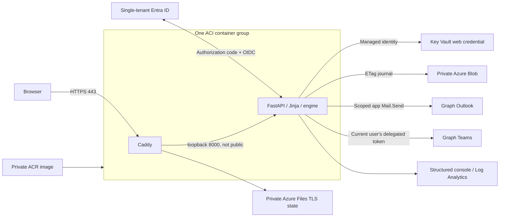

# azd-m365-demo-loader

A security-conscious proof of concept for loading **fictional demo data into an
isolated Microsoft 365 CDX tenant**. Python 3.12, FastAPI, Jinja2, Graph v1.0,
MSAL, Bicep, Azure Container Instances and **Caddy HTTPS reverse proxy**.

Operators upload bounded YAML, inspect resolved identities and planned Graph
operations, dry-run, authorize real email, inspect per-step progress, cancel
future actions, and download content-free reports. Five demo users execute their
own Teams channel messages and replies interactively. This is not bulk-mail
software or a certified production service.

## Architecture



ACI does **not** provide native managed HTTPS ingress. Caddy owns ports 80/443,
obtains and renews ACME certificates, and forwards to the app. ACI does not
expose port 8000. Bring an administrator-controlled public DNS hostname and
point its CNAME at ACI's FQDN. Port 80 is needed for ACME/HTTPS redirects.
Certificate keys persist in a dedicated private Azure Files share; application
state uses a separate Entra-authenticated Blob account. For enterprise ingress
and WAF/private networking options see [architecture](docs/architecture.md).

## Prerequisites and tenant preparation

- Azure subscription with ACI, storage, Key Vault and role-assignment rights,
  plus access to the existing private container registry.
- Azure CLI (`az`), Azure Developer CLI (`azd`), **PowerShell 7**, and Bicep
  (`az bicep install`). Azure CLI must be authenticated separately from azd.
- Python 3.12+ for local development; Linux Docker engine for builds/checks.
- Isolated CDX demo tenant with five licensed, mailbox-enabled users. All Teams
  authors must be members of the mapped existing team/channel.
- Tenant administrator for app consent, application role grants and enterprise
  app assignments; Exchange administrator for mailbox-scoped Application RBAC.
- Public custom DNS and a mailbox for ACME notices for Azure HTTPS deployment.
- Never use production users, customer data, or real business distribution lists.

## Exact permissions and author model

| Identity | Permission | Why / consent |
|---|---|---|
| Interactive web app | delegated `ChannelMessage.Send` | Normal Teams channel posts/replies as signed-in user. Permission is not intrinsically admin-consent-only, but this deployment uses explicit tenant-admin consent. |
| Interactive web app | OIDC `openid`, `profile` | MSAL sign-in and identity claims; no mailbox read. |
| Runtime managed identity / local mail app | application `User.Read.All` | Resolve the five configured UPNs at startup using `/users` with only `id,userPrincipalName` selected; **admin consent required**. |
| Runtime managed identity / local mail app | Exchange RBAC `Application Mail.Send` | `/users/{id}/sendMail`, scoped to five mailboxes by Exchange admin. **Not an additional unscoped Entra Mail.Send grant.** |

Mail.Send supports unattended sending. The preferred authorization is Exchange
Application RBAC rather than a tenant-wide Entra grant. A documented legacy
alternative uses Graph application `Mail.Send` plus an Exchange Application
Access Policy; never combine a broad Entra grant with default RBAC and assume
the latter restricts it. See [permission matrix](docs/graph-permissions.md).

**Teams uses assisted delegated execution (Modes C + A).** Each demo user signs
in and executes only assigned ready actions. Five distinct authors require five
interactive authentications. There is no password storage, ROPC,
`Teamwork.Migrate.All`, beta endpoint, chat support or email-thread reply support.

## Local development

```powershell
python -m venv .venv
.\.venv\Scripts\Activate.ps1
python -m pip install --require-hashes -r requirements.lock
python -m pip install -e ".[dev]"
Copy-Item .env.example .env
```

Configure the ignored `.env` using [Entra setup](docs/entra-setup.md):

- `TENANT_ID`, `WEB_CLIENT_ID`, `WEB_CLIENT_SECRET`.
- `OPERATOR_IDS` as a JSON array of allowed operator object IDs, or
  `AUTHORIZED_GROUP_ID` with emitted direct security-group claims.
- `DEMO_TENANT_CONFIRMED=true` after confirming isolation.
- Separate `MAIL_CLIENT_ID`/`MAIL_CLIENT_SECRET`, with explicit directory and
  scoped Exchange permissions. Do not reuse the interactive application's
  credential for this role.
- Keep `DELIVERY_ENABLED=false` until scope tests pass. Then explicitly set
  `MAILBOX_SCOPE_CONFIRMED=true` and `DELIVERY_ENABLED=true`.

Replace example UPNs in [config/demo-users.yaml](config/demo-users.yaml); exactly
five distinct keys and UPNs are mandatory. Configure channel aliases in
[config/resources.yaml](config/resources.yaml). Never put credentials in either.
Mount configuration outside the image using `USERS_FILE`/`RESOURCES_FILE` for
local Docker if preferred. Keep completed configurations out of public commits.

```powershell
python -m demo_loader.cli examples\demo-scenario.yaml
uvicorn demo_loader.app:create_app --factory --host 127.0.0.1 --port 8000 --no-access-log
```

Open `http://localhost:8000`. Startup resolves all five users and fails explicitly
on missing users, credentials or Graph consent. There is **no local auth bypass**.
Do not expose development HTTP publicly. `.env` supports local secrets but is
ignored by Git and Docker; production uses Key Vault instead.

## Docker and Caddy HTTPS

Both deployment image references live in
[config/container-images.json](config/container-images.json):

| Container | Default image |
|---|---|
| Application | `acrdefcontainer.azurecr.io/azd-m365-demo-loader` |
| Caddy | `acrdefcontainer.azurecr.io/caddy:2.11.4-alpine` |

ACI, Compose and the smoke-test script read this same file. The application
reference without a tag means `:latest`. You may specify an explicit tag or
`@sha256:...` digest for either image; immutable digests are recommended for
repeatable releases. Use fully qualified private registry references.

**Images are built/pushed manually.** Deployment does not create an ACR or
build, push, retag or resolve an image. Configure actual non-secret user/resource
mappings before building the app; they are packaged into the image. Rebuild and
push manually after source or packaged configuration changes.

Example manual publication (requires registry push rights):

```powershell
az acr login --name acrdefcontainer
$images = Get-Content -Raw config\container-images.json | ConvertFrom-Json
docker build -t $images.services.app.image .
docker push $images.services.app.image
docker pull caddy:2.11.4-alpine
docker tag caddy:2.11.4-alpine $images.services.caddy.image
docker push $images.services.caddy.image
```

After both images have been published:

```powershell
# Configure .env: PUBLIC_URL=https://localhost, PUBLIC_HOSTNAME=localhost,
# ACME_EMAIL=your administrative email. Register the HTTPS callback in Entra.
az acr login --name acrdefcontainer
docker compose pull
docker compose up -d
docker compose logs app caddy
docker compose down
```

The Compose app has **no published port**; Caddy alone publishes 80/443 on
loopback. For localhost Caddy uses its local CA: trust its root certificate
explicitly on your test machine/browser, never disable TLS validation for normal
use. Local CA setup is not a publicly trusted certificate and Entra redirect URI
validation still applies. For a public controlled hostname Caddy uses ACME;
publishing Compose ports beyond loopback is an explicit administrator action.
Do not run multiple application replicas or workers. Named volumes preserve the
journal and TLS keys; `docker compose down -v` destroys those records and keys.

Direct image run for loopback-only development is also supported:

```powershell
docker build -t azd-m365-demo-loader:local .
docker run --rm --env-file .env -p 127.0.0.1:8000:8000 `
  --mount type=volume,source=demo-journal,target=/app/data azd-m365-demo-loader:local
```

Use the HTTP localhost PUBLIC_URL and callback for that direct development run.

## Azure deployment with azd

The application uses hooks because ACI is not a built-in azd service host.
No subscription, tenant ID or credential is committed in deployment parameters.
The public hostname, client IDs and operator IDs are supplied at deployment time.

```powershell
azd auth login
az login
azd env new my-demo-loader
azd env set AZURE_LOCATION westeurope
azd env set DEMO_TENANT_CONFIRMED true
azd env set PUBLIC_HOSTNAME loader.your-controlled-domain.example
azd env set ACME_EMAIL your-admin-mailbox@example.org
azd env set WEB_CLIENT_ID <your-web-app-client-id>
azd env set OPERATOR_IDS '["<your-operator-object-id>"]'
# Ensure AZURE_TENANT_ID targets the CDX tenant; azd prompts for subscription.
```

1. Run the idempotent [Entra setup script](scripts/setup-entra.ps1), or follow the
   [manual fallback](docs/entra-setup.md). Assign operators and all five demo
   users (or their allowed group) to the enterprise app; grant delegated consent.
2. First-time identity bootstrap: `azd provision` creates the resource group,
      runtime managed identity, vault, journal storage, certificate share and
   Log Analytics. Read its outputs with `azd env get-values`; keep them private.
      A registry administrator must grant that identity pull access on the existing
      registry; it is not implicitly granted by ACI or managed identity:

      ```powershell
      $registryId = az acr show --name acrdefcontainer --query id -o tsv
      az role assignment create --assignee-object-id <AZURE_IDENTITY_PRINCIPAL_ID> `
        --assignee-principal-type ServicePrincipal --role AcrPull --scope $registryId
      ```

      This command is for a standard RBAC registry. For an ABAC-enabled registry use
      the appropriate **Container Registry Repository Reader** assignment and
      repository conditions instead. If images use different registries, authorize
      the identity on each. Cross-subscription registries require administrator
      access at their scope; cross-tenant pulls are not configured here. Registry
      networking must permit ACI pulls. Bicep supplies managed-identity registry
      credentials for each distinct image registry without storing passwords.
3. Explicitly grant the managed identity `User.Read.All` with
   [grant-graph-identity.ps1](scripts/grant-graph-identity.ps1). Configure the
   five-mailbox scope with [setup-exchange.ps1](scripts/setup-exchange.ps1);
   verify all five allowed mailboxes and a sixth forbidden mailbox.
4. An administrator with **Key Vault Secrets Officer** (not implicitly granted
   to the deployer) stores the interactive app credential in the provisioned
   vault as `web-client-secret`. Use the portal secure value field or a protected
   secret file; do not put the secret on a command line or in azd variables.
5. Set the custom DNS CNAME to
   `<ACI_DNS_LABEL>.<AZURE_LOCATION>.azurecontainer.io` from provision outputs
   (verify the actual FQDN emitted by deployment). The deployment hook also prints
   the actual ACI FQDN. Register `https://<hostname>/auth/callback` in Entra.
6. Configure actual demo users/resources locally and manually build/push the app
   image. Publish Caddy to the configured location as well. The deploy workflow
   does not rebuild packaged configuration or publish images.

Then:

```powershell
azd up
# After scope verification and a successful dry run, enable real sends explicitly:
azd env set MAILBOX_SCOPE_CONFIRMED true
azd env set DELIVERY_ENABLED true
azd deploy
```

Once administrator-owned prerequisites and the manually published images exist,
`azd up` provisions supporting resources, creates/replaces ACI from the configured
image references, and checks the HTTPS health
endpoint. A failed readiness check is a failed deployment, not success.
Propagation of Entra consent, Azure RBAC or DNS can require a later retry.
App registration/consent is deliberately not silently automated by `azd up`.

For updates publish a new image and update its tag/digest in the configuration,
then run `azd deploy`; for infrastructure changes run `azd up`. Prefer a new
immutable reference rather than overwriting `:latest`: an unchanged ACI
declaration is not a reliable image-refresh mechanism.
Changing a running ACI group may briefly interrupt service; journal recovery
marks interrupted writes unknown rather than replaying them.

### OIDC GitHub Actions

[azure-dev.yml](.github/workflows/azure-dev.yml) uses an environment-protected
manual dispatch, `azure/login` and `azd auth login` with GitHub federation.
Use `azd pipeline config` to bootstrap the federated identity/environment, then
configure the variables listed in the workflow. No Azure client secret is used.
The deployment identity needs deployment and supporting-resource role-assignment
rights; it does not need ACR build/push rights, runtime Graph permissions or web-app
credentials. The runtime managed identity needs registry pull access separately.
Complete registry pull authorization and Graph/Exchange/vault bootstrap, and
manually publish both images before dispatch.

## Scenario creation and workflow

Use the portable [Cowork skill](skills/demo-scenario-creator/SKILL.md), its
[example](skills/demo-scenario-creator/examples/scenario.yaml), and
[JSON Schema](schemas/demo-scenario.schema.json). No proprietary Cowork import
mechanism is assumed: attach these as context where import is unavailable.

1. Generate fictional YAML using only configured user keys and channel aliases.
2. Validate offline: `python -m demo_loader.cli scenario.yaml`.
3. Sign in as an operator; upload `.yaml`/`.yml` (default maximum 64 KiB).
4. Inspect identities, recipient keys, sanitized/escaped content and Graph paths.
5. Run the no-write dry-run and download the report.
6. Examples are `dryRun: true`; they cannot execute. For a real reviewed run,
   create a new scenario ID and deliberately set `dryRun: false` before upload.
7. Confirm real delivery; operator starts/resumes ready app-email actions.
8. Sign out/switch identity for each assigned Teams author and execute their
   ready batch. Revisit after dependencies finish; then operator resumes mail.
9. Cancel future actions if needed. Review failures/unknown outcomes manually.
10. Retire completed/cancelled content to remove bodies while retaining replay
    protection. Reports contain statuses, IDs and fixed errors, not message bodies.

See [scenario format](docs/scenario-format.md), [operations](docs/operations.md),
[troubleshooting](docs/troubleshooting.md), [decisions](docs/decisions.md).

## Tests and validation

```powershell
ruff format --check src tests scripts
ruff check src tests scripts
mypy src
pytest -q
python -m demo_loader.cli examples\demo-scenario.yaml
python -m demo_loader.cli skills\demo-scenario-creator\examples\scenario.yaml
python scripts\check-repository.py
bandit -q -r src -c pyproject.toml
pip-audit -r requirements.lock
az bicep build --file infra\main.bicep --stdout
az bicep build --file infra\aci.bicep --stdout
pwsh .\scripts\check-powershell.ps1
docker build -t azd-m365-demo-loader:check .
pwsh .\scripts\smoke-container.ps1 -Image azd-m365-demo-loader:check -CaddyImage caddy:2.11.4-alpine
```

The runtime lock includes hashes generated on Python 3.12. Refresh intentionally
with pip-tools on Python 3.12 and rerun checks; review dependency upgrades.
See [validation results](docs/validation-results.md) for actual local evidence,
including any external prerequisites not exercised.

## Teardown

```powershell
azd down
```

The ACI group created by the deploy hook is in the azd resource group and is
deleted with it. Back up the journal before teardown if replay evidence matters.
The pre-existing registry and manually published images are not deleted. Remove
the retired managed identity's registry-role assignment separately if necessary.
Purge-protected Key Vault remains recoverable for seven days; names cannot be
immediately reused. App registrations, consent, Exchange assignments, federated
pipeline identities and custom DNS are **tenant-level/external resources**, not
removed by azd down. Remove them using [operations](docs/operations.md).

## Security warnings and known limitations

- Single process/replica only; compare-and-swap detects competing writers, not
  high-availability orchestration. No multi-region failover or distributed scheduler.
- No exactly-once remote guarantee; mail HTTP 202 means accepted, not delivered.
  Ambiguous writes are never automatically retried.
- Pending bodies are stored in the journal (encrypted by Azure Storage at rest).
  Access is restricted to authorized demo participants/operators; retire content.
  Local journals require protected disk storage. There is no automatic retention
  deletion that could silently erase replay protection.
- Sessions/delegated tokens live only in server memory, expire within an hour,
  are not refreshed offline, and are lost on restart.
- Explicit group claims only; group overage fails closed. No group-wide Graph
  membership-read permission is requested.
- External recipients are blocked unless an administrator explicitly enables
  `ALLOW_EXTERNAL_RECIPIENTS`; leave this disabled for CDX.
- Application limits: 200 activities/run, 100 stored run/tombstone records by
  default, up to five concurrent Graph calls (two by default), bounded upload,
  session and execution-batch capacity, and global proxy-client request limiting.
- Runtime directory `User.Read.All` is broader than the five users. It exists
  for required startup resolution, not mailbox content access. Mail access must
  be independently scoped and tested.
- The small public ACI design is not a WAF. Caddy and app share the ACI group
  identity trust boundary; harden dependencies and use private ingress for
  higher assurance. Review [SECURITY.md](SECURITY.md) and the
  [threat model](docs/threat-model.md).
